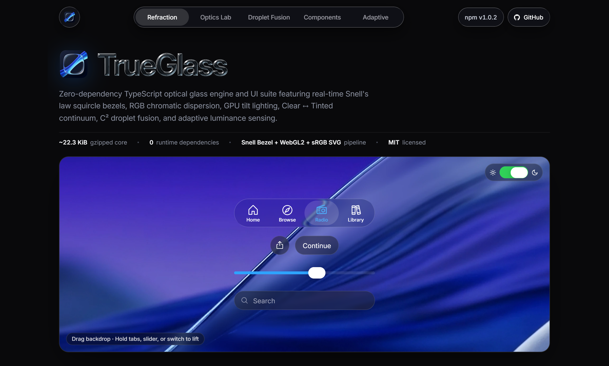
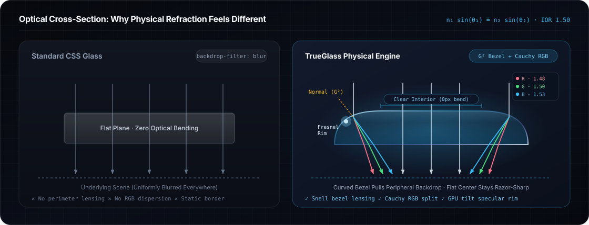
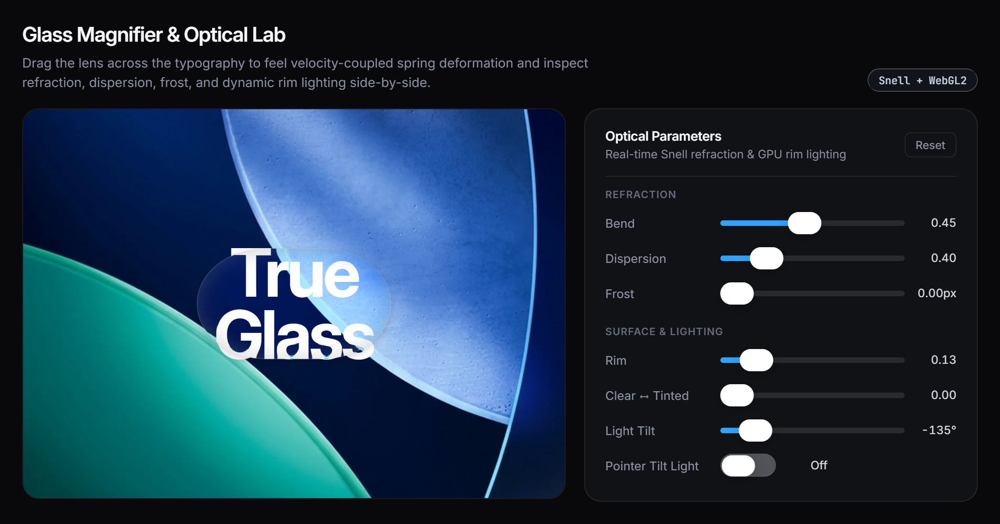
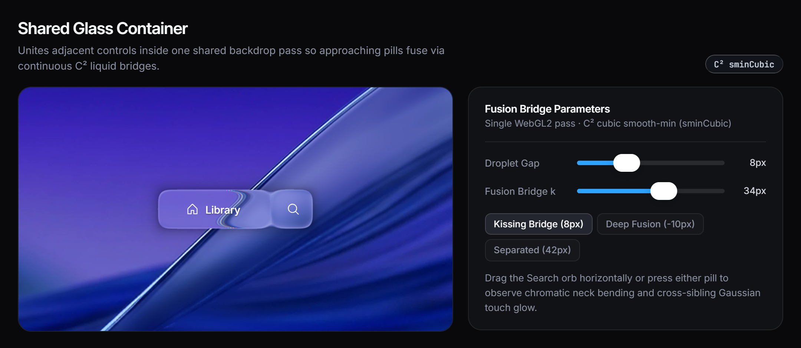
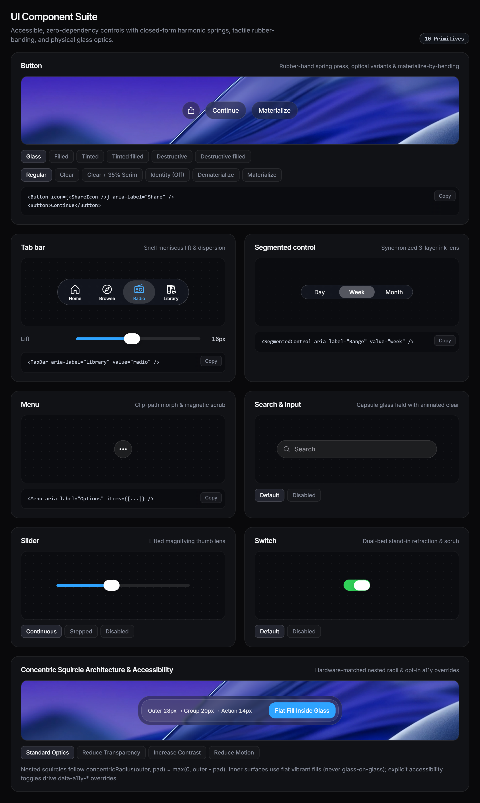
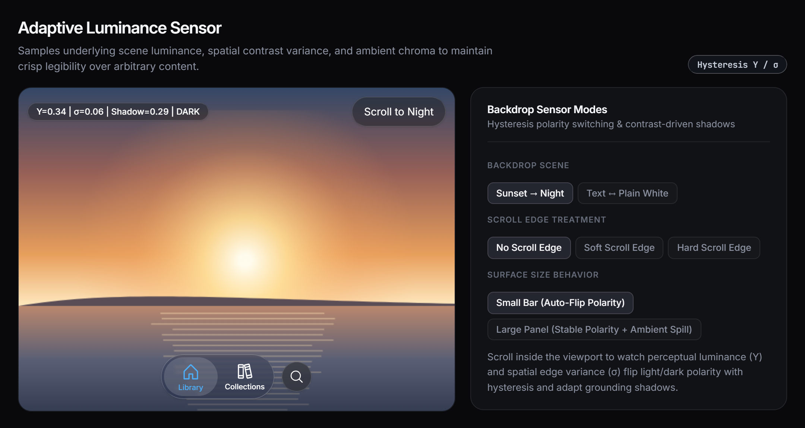
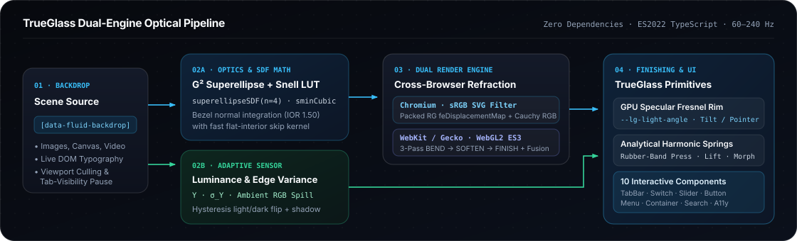

<p align="center">
  
</p>

<h1 align="center">TrueGlass</h1>

<p align="center">
  <strong>True Liquid Glass for the Web — Real Optical Refraction, Droplet Fusion &amp; Tactile UI Components</strong>
</p>

<p align="center">
  Zero dependencies · Works with React, Next.js, Vue, Svelte, Astro &amp; Vanilla JS · Chrome, Safari, Firefox &amp; Mobile
</p>

<p align="center">
  <a href="https://www.npmjs.com/package/trueglass"></a>
  <a href="https://www.npmjs.com/package/trueglass"></a>
  <a href="https://www.npmjs.com/package/trueglass"></a>
  <a href="https://github.com/kicode01/trueglass/blob/main/LICENSE"></a>
  <a href="https://trueglass.vercel.app"></a>
</p>

<p align="center">
  <a href="https://trueglass.vercel.app"><strong>Interactive Demo</strong></a> ·
  <a href="#30-second-quick-start"><strong>Quick Start</strong></a> ·
  <a href="#live-showcase"><strong>Showcase</strong></a> ·
  <a href="#ui-component-suite"><strong>Components</strong></a> ·
  <a href="#headless-core-api"><strong>Core API</strong></a> ·
  <a href="#under-the-hood"><strong>How It Works</strong></a>
</p>

<p align="center">
  <a href="https://trueglass.vercel.app">
    
  </a>
</p>

---

## What is TrueGlass?

**TrueGlass** brings true **liquid glass** optics and tactile fluid physics to the open web — with **zero runtime dependencies** and full TypeScript support.

Most glassmorphism libraries just slap `backdrop-filter: blur(12px)` onto a translucent rectangle. Real liquid glass behaves like a physical optical lens:

- **Real Curved Edge Refraction** — Light, images, and text bend naturally around rounded squircle rims while the flat center stays crisp and readable.
- **Subtle Prismatic Rainbow Edges** — High-curvature rims and lifted droplets split Red, Green, and Blue light just like real optical glass.
- **Tactile Liquid Motion** — Buttons rubber-band when pressed, switches and tab bars lift into magnifying glass droplets when dragged, and menus morph smoothly out of their trigger button.
- **Liquid Droplet Merging** — Place two glass pills close together inside a `GlassContainer` and they smoothly melt into one continuous liquid bridge.
- **Dynamic Specular Rim Lighting** — Edges catch light dynamically as you tilt your phone or move your cursor — rendered purely on the GPU.
- **Auto-Adapts to Any Background** — Scroll a glass bar from a bright photo or white page into dark mode and TrueGlass automatically flips text contrast and adjusts shadows so controls stay legible.
- **Works Across Every Modern Browser** — Uses native GPU-accelerated SVG displacement in Chromium, automatically switches to a custom WebGL2 shader engine in Safari & Firefox, and degrades gracefully on older devices.
- **Accessibility Built In** — One call toggles `Reduce Transparency`, `Increase Contrast`, and `Reduce Motion`.

<p align="center">
  
</p>

### Standard CSS Blur vs. TrueGlass

| Feature | Standard CSS Glass (`backdrop-filter: blur`) | TrueGlass |
| :--- | :--- | :--- |
| **Glass Look** | Flat, cloudy rectangle | Real curved-bezel refraction + crystal-clear center |
| **Edge Prism / Dispersion** | None | Physical R/G/B light separation along curved edges |
| **Merging Controls** | Hard overlapping borders | Smooth liquid droplet fusion (`createGlassContainer`) |
| **Rim Lighting** | Static 1px border | Pure-GPU directional Fresnel rim + cursor/gyro tilt |
| **Tactile Physics** | CSS ease curves | Closed-form spring physics, rubber-band press & lens lift |
| **Background Contrast** | Manual light/dark classes | Auto-adapts polarity, ambient color spill & shadows |
| **Cross-Browser Support** | Inconsistent blur look | Automatic SVG (Chrome/Edge) + WebGL2 (Safari/Firefox) |
| **Accessibility** | DIY | Built-in `reduceTransparency`, `increaseContrast`, `reduceMotion` |

---

## 30-Second Quick Start

### 1. Install

```bash
npm install trueglass
```

Or drop it straight into plain HTML via CDN (no bundler required):

```html
<link rel="stylesheet" href="https://unpkg.com/trueglass@latest/dist-lib/styles.css" />
<script type="module">
  import { createButton, createTabBar } from "https://esm.sh/trueglass@latest";
</script>
```

### 2. Add Liquid Glass UI Controls (Vanilla JS / TypeScript)

```ts
import { createButton, createSlider, createSwitch, createTabBar } from "trueglass";
import "trueglass/styles.css";

// Liquid Glass TabBar with press-and-drag magnifying droplet
const tabs = createTabBar({
  ariaLabel: "Navigation",
  value: "radio",
  items: [
    { value: "home", label: "Home" },
    { value: "browse", label: "Browse" },
    { value: "radio", label: "Radio" },
    { value: "library", label: "Library" },
  ],
  onChange: (tab) => console.log("Selected:", tab),
});

// Rubber-band spring Glass Button
const button = createButton({
  label: "Continue",
  variant: "glass", // "glass" | "filled"
  material: "regular", // "regular" | "clear" | "identity"
  onClick: () => console.log("Clicked!"),
});

// Magnifying-thumb Slider & Dual-bed Switch
const slider = createSlider({ ariaLabel: "Volume", min: 0, max: 100, value: 60 });
const toggle = createSwitch({ ariaLabel: "Dark mode", checked: true });

document.body.append(tabs.element, button.element, slider.element, toggle.element);
```

### 3. Make Glass Refract Your Background (`data-fluid-backdrop`)

Add `data-fluid-backdrop` to any image, canvas, video, or background container. Overlapping TrueGlass elements automatically detect and refract it:

```html
<div class="hero" data-theme="dark">
  
  <div id="glass-hud"></div>
</div>
```

```ts
import { createGlass, refitAllGlass } from "trueglass";
import "trueglass/styles.css";

const card = createGlass({
  className: "my-floating-card",
  material: "regular",
  interactive: true,
});

document.getElementById("glass-hud")!.appendChild(card.element);
refitAllGlass();
```

### 4. Using with React / Next.js (or Vue, Svelte, Solid)

TrueGlass is framework-agnostic and owns zero global CSS resets. Wrap any ref in a `useEffect` (or attach headless optics directly to your existing JSX elements):

```tsx
import { useEffect, useRef } from "react";
import { attachInteractivePress, attachRefraction } from "trueglass/core";
import "trueglass/styles.css";

export function LiquidGlassPill({ children }: { children: React.ReactNode }) {
  const ref = useRef<HTMLButtonElement>(null);

  useEffect(() => {
    const el = ref.current;
    if (!el) return;
    const refraction = attachRefraction(el);
    const stopPress = attachInteractivePress(el);
    return () => {
      stopPress();
      refraction.destroy();
    };
  }, []);

  return (
    <button ref={ref} className="lg-glass lg-button" type="button">
      {children}
    </button>
  );
}
```

### Package Entrypoints

| Import Path | What It Includes |
| :--- | :--- |
| `trueglass` | Everything — headless optical engine + all 10 UI components |
| `trueglass/core` | Headless engine only (refraction, springs, SDF math, adaptive sensor, a11y) |
| `trueglass/components` | Ready-to-use interactive UI component factories |
| `trueglass/styles.css` | Scoped `.lg-*` component & token styles (zero global resets) |

---

## Live Showcase

Try every demo interactively in your browser at **[trueglass.vercel.app](https://trueglass.vercel.app)**.

### 1. Glass Magnifier & Optical Lab
Drag the velocity-reactive glass lens across typography and dial in **Bend**, **Chromatic Dispersion**, **Frost**, **Rim Specular**, **Clear ↔ Tinted**, and **GPU Light Tilt** live.

<p align="center">
  <a href="https://trueglass.vercel.app/#optics-lab">
    
  </a>
</p>

### 2. Shared Glass Container · Liquid Droplet Fusion
Two separate controls rendered in one shared WebGL2 pass — drag the Search orb closer to the Library pill and watch them melt together with a smooth liquid neck and cross-sibling touch glow.

<p align="center">
  <a href="https://trueglass.vercel.app/#droplet-fusion">
    
  </a>
</p>

### 3. UI Component Suite & Concentric Architecture
Ten zero-dependency Liquid Glass primitives — **Button**, **TabBar**, **SegmentedControl**, **Menu**, **SearchField**, **Input**, **Slider**, **Switch**, **Glass**, and **GlassContainer** — designed with concentric squircle radii and built-in accessibility modes.

<p align="center">
  <a href="https://trueglass.vercel.app/#components">
    
  </a>
</p>

### 4. Adaptive Luminance & Contrast Sensor
Scroll a floating navigation bar from a golden-hour sunset across high-contrast editorial text into a dark starry night — TrueGlass measures luminance and edge contrast in real time to flip light/dark polarity and adapt grounding shadows automatically.

<p align="center">
  <a href="https://trueglass.vercel.app/#adaptive">
    
  </a>
</p>

---

## UI Component Suite

All component factories are exported from `trueglass` and `trueglass/components`:

| Component | Highlights | Key Options |
| :--- | :--- | :--- |
| **`createGlass`** | Universal refracting container with auto `[data-fluid-backdrop]` binding & materialize transitions | `className`, `tag`, `interactive`, `material` (`regular \| clear \| identity`), `dimmingScrim`, `materializeOnMount` |
| **`createGlassContainer`** | Single-pass WebGL2 droplet fusion container (`sminCubic` liquid necks + cross-sibling glow) | `childrenVariants`, `backdropSrc`, `gap`, `smoothK`, `tint`, `ariaLabel`, `onGapChange` |
| **`createButton`** | Pill glass or filled button with rubber-band spring press, contact glow & materialize-by-bending | `label`, `iconHtml`, `ariaLabel`, `variant` (`glass \| filled`), `material`, `dimmingScrim`, `destructive`, `tint`, `iconOnly`, `disabled`, `onClick` |
| **`createTabBar`** | Capsule navigation bar with press-and-drag magnifying droplet lens & chromatic edge dispersion | `items` (`{ value, label, iconHtml? }[]`), `value`, `ariaLabel`, `className`, `onChange` |
| **`createSegmentedControl`** | Synchronized 3-layer ink lens segmented selector with spring sliding thumb | `items`, `value`, `ariaLabel`, `className`, `onChange` |
| **`createSwitch`** | Dual-bed refraction toggle switch with spring lift, drag scrubbing & bounded overshoot | `checked`, `disabled`, `ariaLabel`, `className`, `onChange` |
| **`createSlider`** | Continuous or stepped slider whose thumb lifts into a `60×40px` magnifying lens over the track | `min`, `max`, `step`, `value`, `disabled`, `ariaLabel`, `className`, `onInput` |
| **`createMenu`** | Trigger-to-card `clip-path` morphing popover with rubber resistance & magnetic row scrubbing | `ariaLabel`, `triggerIconHtml`, `align` (`start \| end`), `items` |
| **`createSearchField`** & **`createInput`** | Capsule glass search & text fields with animated clear button and focus ring | `placeholder`, `value`, `disabled`, `ariaLabel`, `className`, `onInput` |

Every component returns a clean imperative handle with `.element`, state getters/setters, `.refit()`, and `.destroy()`.

---

## Headless Core API (`trueglass/core`)

Build your own custom glass components using the underlying optical engine directly:

| Module | Key Exports | What It Does |
| :--- | :--- | :--- |
| [refraction.ts](src/core/refraction.ts) | `attachRefraction`, `refitAllRefractions`, `materializeAllRefractions`, `rimMap`, `GLASS` | Auto-discovers `[data-fluid-backdrop]`, paints Fresnel rims, manages viewport-culled & idle-sleeping refraction updates. |
| [lens.ts](src/core/lens.ts) | `createLens`, `createBackdropLens`, `fitBackdropLens`, `lensMap`, `lensField` | Generates packed-RG sRGB `<feDisplacementMap>` SVG filter graphs with Cauchy RGB dispersion and stand-in masking. |
| [drawn.ts](src/core/drawn.ts) | `createDrawnLens`, `drawsLens` | 3-stage WebGL2 (`BEND → SOFTEN → FINISH`) backdrop rasterizer for Safari & Firefox. |
| [optics.ts](src/core/optics.ts) | `superellipseSDF`, `squircleSDF`, `sminCubic`, `concentricRadius`, `computeBezelProfile`, `generateOpticalMaps` | $G^2$ $L^4$ superellipse SDFs, $C^2$ cubic smooth-min union, hardware concentric radius solver, and Snell bezel lookup tables. |
| [spring.ts](src/core/spring.ts) | `createSpring`, `advanceSpringState`, `isReducedMotion` | Closed-form 2nd-order harmonic spring solver (60–240 Hz, zero Euler drift). |
| [adaptive-sensor.ts](src/core/adaptive-sensor.ts) | `analyzeBackdropPixels`, `attachAdaptiveBackdropSensor` | Samples perceptual luminance ($Y$), horizontal edge variance ($\sigma_Y$), and ambient color with hysteresis polarity switching. |
| [interaction.ts](src/core/interaction.ts) | `attachInteractivePress`, `attachVirtualTiltLight`, `setAccessibilityModes`, `getAccessibilityModes` | Anisotropic rubber-band press physics, pointer/gyroscope specular rim tilt, and global accessibility toggles. |
| [webgl-stage.ts](src/core/webgl-stage.ts) | `drawCrossSectionRays`, `createWebGLBackdropLens`, `readElementRegionPixels` | Interactive Snell's law cross-section ray tracer and standalone WebGL2 lens stage. |

---

## CSS Tokens & Accessibility

Customize every optical property with standard CSS variables ([src/trueglass.css](src/trueglass.css)):

| CSS Variable | Default (Dark / Light) | Effect |
| :--- | :--- | :--- |
| `--lg-glass-bend` | `2` (`3.4` on `TabBar`) | Curved bezel refraction strength |
| `--lg-glass-dispersion` | `0.6` (`2.6` on `TabBar`) | R/G/B prismatic edge separation |
| `--lg-ior` | `1.5` | Refractive index passed to Snell's law |
| `--lg-blur` | `3px` (`2px` on `TabBar`) | Interior frost blur radius |
| `--lg-tint-amount` | `0` (`0..1`) | Continuous Clear ↔ Tinted surface density |
| `--lg-rim-shine` | `0.13` / `0.30` | Specular Fresnel rim highlight brightness |
| `--lg-light-angle` | `-135` (deg) | Directional specular light angle (live-animated on tilt) |
| `--lg-ambient-spill` | `transparent` | Mean backdrop color tint on large adaptive surfaces |
| `--lg-adaptive-shadow` | dynamic (`0.06..0.42`) | Contrast-driven grounding shadow opacity |

### Accessibility Overrides

```ts
import { setAccessibilityModes } from "trueglass";

setAccessibilityModes({
  reduceTransparency: true, // Solid high-legibility plates (data-a11y-transparency="reduce")
  increaseContrast: true,   // Crisp 1.5px foreground borders (data-a11y-contrast="high")
  reduceMotion: true,       // Instant spring settling & 0ms transitions (data-a11y-motion="reduce")
});
```

---

## Under the Hood

For engineers curious about how TrueGlass achieves 60–240 Hz physical refraction in the browser:

<p align="center">
  
</p>

1. **Geometry ($G^2$ Superellipses & $C^2$ Fusion)** — Glass shapes use $L^4$ superellipse signed distance fields (`superellipseSDF`) for curvature-continuous squircle corners, and cubic smooth-minimum (`sminCubic`) for smooth liquid bridges inside `createGlassContainer`.
2. **Physics (Snell's Law + Flat-Interior Skip)** — Surface normals along the curved bezel refract rays via $n_1 \sin\theta_1 = n_2 \sin\theta_2$ (`IOR 1.50`) while a fast flat-interior skip kernel bypasses the unbent center pixels.
3. **Dual Render Engine** — Chromium renders packed-RG `<feDisplacementMap>` SVG filters in locked sRGB space; Safari and Firefox automatically use a 3-pass WebGL2 pipeline (`BEND → SOFTEN → FINISH`). Both engines pause automatically when off-screen, idle, or in background tabs.
4. **Pure-GPU Rim Lighting** — Instead of re-baking rim textures on the CPU when tilting, specular highlights are driven directly on the GPU via `--lg-light-angle` (`--lg-lx`, `--lg-ly`).

---

## Development

```bash
npm install          # Install dev dependencies
npm run dev          # Start local Optical Studio at http://localhost:5173/
npm test             # Run Vitest unit test suite
npm run build        # Type-check and build showcase web app to dist/
npm run build:lib    # Build npm package (ESM + .d.ts + styles.css) to dist-lib/
```

---

## License

Released under the [MIT License](LICENSE).
