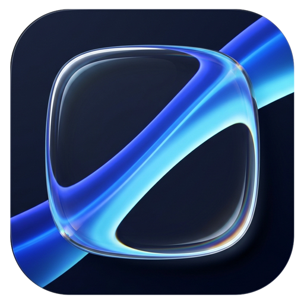
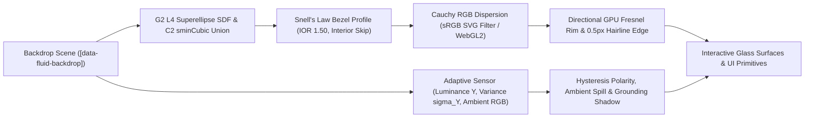

<p align="center">
  
</p>

<h1 align="center">TrueGlass</h1>

<p align="center">
  <strong>Physically-Based Optical Glass Engine &amp; UI Component Suite for the Web</strong>
</p>

<p align="center">
  <a href="https://www.npmjs.com/package/trueglass"></a>
  <a href="https://www.npmjs.com/package/trueglass"></a>
  <a href="https://github.com/kicode01/trueglass/blob/main/LICENSE"></a>
  <a href="https://trueglass.vercel.app"></a>
</p>

<p align="center">
  <a href="https://trueglass.vercel.app"><strong>Live Studio</strong></a> ·
  <a href="https://www.npmjs.com/package/trueglass"><strong>npm Package</strong></a> ·
  <a href="#installation"><strong>Installation</strong></a> ·
  <a href="#ui-component-suite"><strong>Components</strong></a> ·
  <a href="#headless-core-api"><strong>Core API</strong></a> ·
  <a href="#css-tokens--accessibility"><strong>Tokens &amp; A11y</strong></a>
</p>

---

## Overview

**TrueGlass** is a zero-dependency, physically-based optical engine and interactive UI component library written in strict TypeScript (`ES2022`). Rather than relying on uniform `backdrop-filter: blur(...)` overlays, TrueGlass models real optical glass:

- **Snell's Law Bezel Refraction**: Precomputed $G^2$ superellipse ($L^4$) corner normals and surface height profiles bend underlying pixels along curved glass rims while leaving flat interior centers distortion-free.
- **Cauchy RGB Chromatic Dispersion**: Splits Red, Green, and Blue rays across separate refractive indices along high-curvature bezels and lifted droplet meniscuses.
- **Dual-Engine Cross-Browser Pipeline**: Combines an sRGB-locked `<feDisplacementMap>` SVG filter graph with a 3-stage WebGL2 shader pipeline (`BEND` / `SOFTEN` / `FINISH`) for environments without SVG `backdrop-filter` support, complete with off-screen viewport culling and background-tab pausing.
- **Single-Pass $C^2$ Droplet Fusion**: Evaluates sibling glass controls inside a shared WebGL2 pass using cubic smooth-minimum (`sminCubic(d1, d2, k)`), producing continuous liquid necks and cross-sibling Gaussian touch illumination.
- **Pure-GPU Dynamic Specular Rim Lighting**: Drives dual-lobe directional Fresnel rim highlights directly on the GPU via `--lg-light-angle` (`--lg-lx`, `--lg-ly`), paired with lazy pointer parallax and device-orientation tilt (`attachVirtualTiltLight`) with shortest-arc `±180°` seam unwrapping.
- **Closed-Form 2nd-Order Harmonic Springs**: Analytical differential equation solver across underdamped, critically damped, and overdamped regimes at 60–240 Hz without numerical Euler drift.
- **Event-Driven Adaptive Luminance & Contrast Sensor**: Samples underlying scene luminance ($Y$), horizontal edge-contrast variance ($\sigma_Y$), and ambient chroma with hysteresis to automatically flip light/dark control polarity, project ambient color spill onto large panels, and modulate grounding shadows over high-contrast typography vs. uniform surfaces.
- **First-Class Accessibility Overrides**: Built-in `reduceTransparency`, `increaseContrast`, and `reduceMotion` modes scoped cleanly to `:root[data-a11y-*]`.

---

## Optical Architecture



### Feature Matrix

| Capability | Standard CSS Glass (`backdrop-filter: blur`) | TrueGlass |
| :--- | :--- | :--- |
| **Perimeter Refraction** | Uniform flat blur across entire box | Snell's law $G^2$ superellipse bezel + clear interior |
| **Chromatic Dispersion** | None | Multi-channel Cauchy R/G/B refractive split |
| **Cross-Browser Engine** | Single CSS property | sRGB SVG filter graph + 3-stage WebGL2 rasterizer |
| **Droplet Merging** | Hard overlapping borders | Single-pass WebGL2 $C^2$ `sminCubic` liquid bridge fusion |
| **Specular Rim Lighting** | Static border color | Pure-GPU directional Fresnel rim + pointer/gyroscope tilt |
| **Backdrop Adaptation** | Manual theme classes | Hysteresis luminance ($Y$) & edge-variance ($\sigma_Y$) sensor |
| **Material Continuum** | Single opacity | `regular` / `clear` / `scrim` / `identity` + materialize-by-bending |
| **Accessibility** | Manual overrides required | Built-in `reduceTransparency`, `increaseContrast`, `reduceMotion` |

---

## Installation

```bash
npm install trueglass
```

Or use directly in browser modules via CDN:

```html
<link rel="stylesheet" href="https://unpkg.com/trueglass@1.0.0/dist-lib/styles.css" />
<script type="module">
  import { createButton, createTabBar } from "https://esm.sh/trueglass@1.0.0";
</script>
```

### Package Entrypoints

| Import Path | Description |
| :--- | :--- |
| `trueglass` | Full library: headless optical core + all interactive UI components |
| `trueglass/core` | Headless optical engine only (refraction, springs, SDF math, adaptive sensor, a11y) |
| `trueglass/components` | Interactive UI component factories (`createButton`, `createTabBar`, `createGlass`, etc.) |
| `trueglass/styles.css` | Isolated `.lg-*` component & token stylesheet (zero global page resets) |

---

## Quick Start

### 1. Interactive UI Components

```ts
import { createButton, createSlider, createSwitch, createTabBar } from "trueglass";
import "trueglass/styles.css";

// 1. Pill button with rubber-band spring press & optical materialize-by-bending
const button = createButton({
  label: "Continue",
  variant: "glass", // "glass" | "filled"
  material: "regular", // "regular" | "clear" | "identity"
  onClick: () => console.log("Clicked"),
});

// 2. Capsule TabBar with lifted Snell meniscus lens & prismatic dispersion
const tabs = createTabBar({
  ariaLabel: "Navigation",
  value: "radio",
  items: [
    { value: "home", label: "Home" },
    { value: "browse", label: "Browse" },
    { value: "radio", label: "Radio" },
    { value: "library", label: "Library" },
  ],
  onChange: (value) => console.log("Selected tab:", value),
});

// 3. Dual-bed refraction Switch & lifted-thumb Slider
const toggle = createSwitch({
  ariaLabel: "Dark appearance",
  checked: true,
  onChange: (checked) => console.log("Switch:", checked),
});

const slider = createSlider({
  ariaLabel: "Volume",
  min: 0,
  max: 100,
  value: 60,
  onInput: (val) => console.log("Slider:", val),
});

document.body.append(tabs.element, button.element, toggle.element, slider.element);
```

### 2. Linking Glass Surfaces to a Rich Backdrop (`[data-fluid-backdrop]`)

Mark any image, canvas, video, or container with `data-fluid-backdrop` so overlapping TrueGlass elements automatically bind and refract its content:

```html
<div class="hero-stage" data-theme="dark">
  
  <div id="hud"></div>
</div>
```

```ts
import { createGlass, refitAllGlass } from "trueglass";
import "trueglass/styles.css";

const card = createGlass({
  className: "my-floating-card",
  material: "regular",
  interactive: true,
});

document.getElementById("hud")!.appendChild(card.element);
refitAllGlass();
```

### 3. Headless Optics on Custom DOM Elements (`trueglass/core`)

Apply TrueGlass refraction, tactile rubber-band press physics, and adaptive luminance sensing to your own components:

```ts
import {
  analyzeBackdropPixels,
  attachAdaptiveBackdropSensor,
  attachInteractivePress,
  attachRefraction,
  setAccessibilityModes,
} from "trueglass/core";
import "trueglass/styles.css";

const customEl = document.querySelector<HTMLElement>(".my-pill")!;
customEl.classList.add("lg-glass");

const refraction = attachRefraction(customEl);
const stopPress = attachInteractivePress(customEl);

// Trigger optical materialize / dematerialize transition
refraction.dematerialize();
setTimeout(() => refraction.materialize(), 400);

// Clean up when unmounting
function destroy() {
  stopPress();
  refraction.destroy();
}
```

---

## UI Component Suite

All component factories are exported from `trueglass` (and `trueglass/components`):

### `createGlass(options)`
Universal refractive container with automatic `[data-fluid-backdrop]` binding.
- **Options**: `{ className?, tag?, interactive?, materializeOnMount?, material?: "regular" | "clear" | "identity", dimmingScrim?: boolean }`
- **Handle**: `{ element, refraction, materialize(instant?), dematerialize(instant?), setMaterial(material, dimmingScrim?), refit(), destroy() }`

### `createGlassContainer(options)`
Single-pass WebGL2 container that fuses adjacent controls with $C^2$ cubic smooth-minimum (`sminCubic`) liquid bridges, chromatic neck dispersion, and cross-sibling pointer glow. Enforces homogeneous material variants (`"regular"` and `"clear"` children cannot be mixed).
- **Options**: `{ childrenVariants, backdropSrc?, gap?: number, smoothK?: number, tint?: number, ariaLabel?, onGapChange? }`
- **Handle**: `{ element, setGap(px), getGap(), setSmoothK(k), getSmoothK(), setTint(t), setBackdropSrc(url), refit(), destroy() }`

### `createButton(options)`
Tactile glass or filled pill button with anisotropic rubber-band press physics, internal pointer-contact glow, and optical materialize-by-bending.
- **Options**: `{ label?, iconHtml?, ariaLabel?, variant?: "glass" | "filled", material?, dimmingScrim?, destructive?, tint?, iconOnly?, disabled?, materializeOnMount?, onClick? }`

### `createTabBar(options)` & `createSegmentedControl(options)`
Capsule navigation bars with a press-and-drag lifted magnifying droplet lens, curved Snell meniscus backdrop refraction, and luminous chromatic dispersion.
- **Options**: `{ items: Array<{ value, label, iconHtml? }>, value?, ariaLabel?, className?, onChange? }`
- **Handle**: `{ element, getValue(), setValue(next, instant?), refit(), destroy() }`

### `createSwitch(options)`
Dual-bed stand-in refraction toggle switch with exclusion masking, spring thumb lift, drag scrubbing, and asymptotic bounded overshoot.
- **Options**: `{ checked?, disabled?, ariaLabel, className?, onChange? }`
- **Handle**: `{ element, getChecked(), setChecked(next), setDisabled(disabled), destroy() }`

### `createSlider(options)`
Continuous or stepped range slider whose thumb lifts into a 60×40px magnifying glass lens refracting the inset track and fill bar.
- **Options**: `{ min?, max?, step?, value?, disabled?, ariaLabel, className?, onInput? }`
- **Handle**: `{ element, input, getValue(), setValue(next), setStep(step), setDisabled(disabled), destroy() }`

### `createMenu(options)`
Trigger-to-card `clip-path` morphing popover menu with scale-coupled blur/shadow spread, icon blur drift, exponential rubber resistance, and magnetic row scrubbing.
- **Options**: `{ ariaLabel, triggerIconHtml?, align?: "start" | "end", items: Array<MenuEntryItem | { type: "separator" }> }`
- **Handle**: `{ element, isOpen(), open(), close(), toggle(), destroy() }`

### `createSearchField(options)` & `createInput(options)`
Capsule glass text and search inputs with animated clear action and focus ring.
- **Options**: `{ placeholder?, value?, disabled?, ariaLabel?, className?, onInput? }`
- **Handle**: `{ element, input, setDisabled(disabled), destroy() }`

---

## Headless Core API (`trueglass/core`)

| Module | Exports | Purpose |
| :--- | :--- | :--- |
| [optics.ts](src/core/optics.ts) | `superellipseSDF`, `squircleSDF`, `squircleNormal`, `sminCubic`, `sminCubicGradient`, `concentricRadius`, `computeBezelProfile`, `sampleBezelProfile`, `generateOpticalMaps`, `benchmarkOptics` | $G^2$ $L^4$ superellipse SDFs, $C^2$ smooth-min union & analytic gradients, hardware concentric radius solver, Snell bezel LUTs, and flat-interior-skipping `Uint32Array` kernel. |
| [lens.ts](src/core/lens.ts) | `createLens`, `createBackdropLens`, `fitBackdropLens`, `lensMap`, `lensField`, `distance`, `shapeOf`, `tuningOf` | sRGB `<feDisplacementMap>` SVG filter graph generator, multi-channel chromatic dispersion, and stand-in exclusion masking. |
| [refraction.ts](src/core/refraction.ts) | `GLASS`, `rimMap`, `attachRefraction`, `refitAllRefractions`, `materializeAllRefractions` | Automatic `[data-fluid-backdrop]` discovery, viewport-culled surface tracking, interior-skipping Fresnel rim painter, and spring bend transitions. |
| [drawn.ts](src/core/drawn.ts) | `createDrawnLens`, `drawsLens` | 3-stage WebGL2 (`BEND` / `SOFTEN` / `FINISH`) backdrop rasterizer for non-SVG `backdrop-filter` browsers. |
| [spring.ts](src/core/spring.ts) | `createSpring`, `advanceSpringState`, `isReducedMotion` | Closed-form 2nd-order harmonic oscillator supporting underdamped, critically damped, and overdamped motion. |
| [adaptive-sensor.ts](src/core/adaptive-sensor.ts) | `analyzeBackdropPixels`, `attachAdaptiveBackdropSensor` | Perceptual luminance ($Y$), horizontal edge-contrast variance ($\sigma_Y$), ambient RGB spill, and hysteresis polarity switching. |
| [interaction.ts](src/core/interaction.ts) | `attachInteractivePress`, `attachVirtualTiltLight`, `setAccessibilityModes`, `getAccessibilityModes` | Anisotropic rubber-band pointer stretch, contact glow coordinates, shortest-arc pointer/gyroscope light tilt, and accessibility state manager. |
| [webgl-stage.ts](src/core/webgl-stage.ts) | `drawCrossSectionRays`, `createWebGLBackdropLens`, `readElementRegionPixels` | Interactive Snell's law cross-section ray tracer and standalone WebGL2 lens stage. |

---

## CSS Tokens & Accessibility

### Optical & Surface Custom Properties ([src/trueglass.css](src/trueglass.css))

| Custom Property | Default (Dark / Light) | Description |
| :--- | :--- | :--- |
| `--lg-glass-bend` | `2` (`3.4` on `TabBar`) | Refracted squircle bezel displacement reach scalar. |
| `--lg-glass-dispersion` | `0.6` (`2.6` on `TabBar`) | Cauchy R/G/B chromatic separation strength along curved edges. |
| `--lg-ior` | `1.5` | Index of refraction passed to the Snell bezel solver. |
| `--lg-blur` | `3px` (`2px` on `TabBar`) | Interior frost blur radius before tint modulation. |
| `--lg-tint-amount` | `0` (`0..1`) | Continuous Clear ↔ Tinted surface density scalar. |
| `--lg-rim-shine` | `0.13` / `0.30` | Specular Fresnel rim highlight intensity. |
| `--lg-light-angle` | `-135` (degrees) | Specular rim light vector angle (rotates live on tilt or slider input). |
| `--lg-ambient-spill` | `transparent` | Backdrop mean chroma tint applied to large adaptive panels. |
| `--lg-adaptive-shadow` | dynamic (`0.06..0.42`) | Edge-contrast-driven grounding shadow opacity scalar. |

### Accessibility Modes (`setAccessibilityModes`)

```ts
import { setAccessibilityModes } from "trueglass";

setAccessibilityModes({
  reduceTransparency: true, // Sets data-a11y-transparency="reduce" on <html>
  increaseContrast: true,   // Sets data-a11y-contrast="high" on <html>
  reduceMotion: true,       // Sets data-a11y-motion="reduce" on <html>
});
```

| Mode | Root Attribute | Effect |
| :--- | :--- | :--- |
| `reduceTransparency` | `data-a11y-transparency="reduce"` | Replaces translucent glass fills with high-legibility `--lg-surface` plates while excluding active overlay lenses and filled buttons. |
| `increaseContrast` | `data-a11y-contrast="high"` | Adds crisp `1.5px` high-contrast foreground borders and outer separation shadows. |
| `reduceMotion` | `data-a11y-motion="reduce"` | Collapses CSS transition durations and snaps harmonic springs instantaneously to target values. |

---

## Development & Packaging

```bash
npm install          # Install dependencies
npm run dev          # Start local Optical Studio showcase at http://localhost:5173/
npm test             # Run Vitest unit test suite
npm run build        # Type-check and build showcase web app to dist/
npm run build:lib    # Build npm package (ESM + .d.ts + styles.css) to dist-lib/
```

---

## License

Released under the [MIT License](LICENSE).
