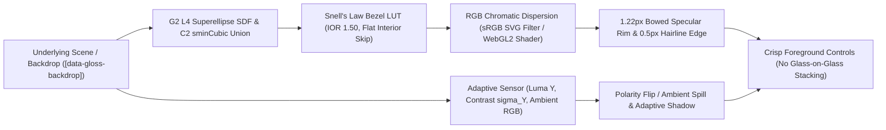

# Gloss — Fluid Glass Engine & UI Suite

A zero-dependency, physically-based **Fluid Glass** optical engine and interactive UI component library built in strict TypeScript (`ES2022`). Gloss replaces uniform translucent blurs with real-time Snell's law bezel refraction, Cauchy RGB chromatic dispersion, continuous-curvature $G^2$ superellipse geometry, dynamic specular rim lighting, closed-form analytical spring physics, and $C^2$ cubic smooth-min (`sminCubic`) droplet fusion.

---

## Key Capabilities

- **Zero Runtime Dependencies**: Pure TypeScript & Web Platform APIs (~22.3 KiB gzipped core engine; ~27.2 KiB gzipped with the full component suite).
- **Hybrid Optical Pipeline**:
  - **sRGB-Locked SVG Filter Graph** ([src/core/lens.ts](src/core/lens.ts), [src/core/refraction.ts](src/core/refraction.ts)): Multi-channel `<feDisplacementMap>` with RGB chromatic split and an exact `inside`/`outside` alpha composite that leaves flat center interiors crystal-clear.
  - **Shared WebGL2 Shaders & Cross-Browser Rasterizer** ([src/core/drawn.ts](src/core/drawn.ts), [src/core/webgl-stage.ts](src/core/webgl-stage.ts)): Hardware GPU `BEND` / `SOFTEN` / `FINISH` shader passes plus automatic fallback for browsers without SVG `backdrop-filter: url(...)` support.
- **$G^2$ Superellipse ($L^4$) Geometry & Snell's Law Profiles** ([src/core/optics.ts](src/core/optics.ts)): Continuous-curvature squircle corner normals and precomputed Snell's law displacement LUTs eliminate $G^1$ specular kinks around rounded corners.
- **$C^2$ Droplet Fusion & Light Bleed (`createGlassContainer`)**: Evaluates multiple controls inside a single unified WebGL2 backdrop pass using `sminCubic(d1, d2, k)`, rendering continuous liquid bridges, RGB neck dispersion, Schlick Fresnel rims, and Gaussian pointer illumination bleeding across sibling controls.
- **Closed-Form 2nd-Order Harmonic Springs** ([src/core/spring.ts](src/core/spring.ts)): Analytical solver covering underdamped, critically damped, and overdamped motion at 60–240 Hz without Euler drift.
- **Adaptive Luminance & Contrast Sensor** ([src/core/adaptive-sensor.ts](src/core/adaptive-sensor.ts)): Samples backdrop luminance $Y$, horizontal spatial contrast variance $\sigma_Y$, and ambient chroma with hysteresis to flip light/dark polarity (`small`/`medium` controls), lock polarity with ambient color spill (`large` panels), and modulate grounding shadow opacity over text vs. plain white regions.
- **Explicit Accessibility Controls** ([src/core/interaction.ts](src/core/interaction.ts), [src/styles.css](src/styles.css)): Opt-in `Reduce Transparency`, `Increase Contrast`, and `Reduce Motion` overrides scoped cleanly to `:root[data-a11y-*]` attributes.

---

## Optical Pipeline & Architecture



---

## Getting Started

```bash
npm install
npm run dev      # Start Vite development playground on http://localhost:5173/
npm test         # Run Vitest unit test suite
npm run build    # Type-check with tsc --noEmit and build production assets to dist/
```

---

## Core Engine API (`src/core`)

| Module | Key Exports | Purpose |
| :--- | :--- | :--- |
| [optics.ts](src/core/optics.ts) | `superellipseSDF`, `sminCubic`, `sminCubicGradient`, `concentricRadius`, `computeBezelProfile`, `generateOpticalMaps`, `benchmarkOptics` | $G^2$ squircle math, $C^2$ union blending, Snell bezel LUTs, and flat-interior-skipping `Uint32Array` map kernel. |
| [lens.ts](src/core/lens.ts) | `createLens`, `createBackdropLens`, `fitBackdropLens`, `lensMap`, `lensField`, `distance`, `shapeOf` | sRGB `<feDisplacementMap>` SVG filter graph generator, $L^4$ corner normals, and stand-in exclusion masking. |
| [refraction.ts](src/core/refraction.ts) | `GLASS`, `rimMap`, `attachRefraction`, `refitAllRefractions`, `materializeAllRefractions` | Lazy `[data-gloss-backdrop]` binding, up to 3x DPR anisotropic Fresnel rim painting, and spring materialize/dematerialize. |
| [drawn.ts](src/core/drawn.ts) | `createDrawnLens`, `drawsLens` | WebGL2 three-stage (`BEND`/`SOFTEN`/`FINISH`) backdrop lens renderer for non-SVG `backdrop-filter` engines. |
| [spring.ts](src/core/spring.ts) | `createSpring`, `advanceSpringState`, `isReducedMotion` | Closed-form 2nd-order differential spring animator across all damping regimes. |
| [adaptive-sensor.ts](src/core/adaptive-sensor.ts) | `analyzeBackdropPixels`, `attachAdaptiveBackdropSensor` | Real-time luminance, edge-contrast variance, hysteresis polarity flipping, and ambient color spill tracking. |
| [interaction.ts](src/core/interaction.ts) | `attachInteractivePress`, `attachVirtualTiltLight`, `setAccessibilityModes`, `getAccessibilityModes` | Anisotropic rubber-band pointer stretch, internal finger contact glow, tilt lighting, and `data-a11y-*` toggles. |
| [webgl-stage.ts](src/core/webgl-stage.ts) | `drawCrossSectionRays`, `createWebGLBackdropLens`, `readElementRegionPixels` | Interactive cross-section Snell ray visualizer and standalone WebGL2 lens stage. |

---

## UI Component Suite (`src/components`)

Import directly from [src/components/index.ts](src/components/index.ts) (alongside [src/styles.css](src/styles.css)):

* **`createGlass(options)`**: Universal Fluid Glass container with automatic `[data-gloss-backdrop]` linking, `material` variants (`"regular" | "clear" | "identity"`), optional `dimmingScrim`, and `materialize()` / `dematerialize()`.
* **`createGlassContainer(options)`**: Shared sampling container uniting child pills inside one WebGL2 pass with `sminCubic` liquid bridge morphing, chromatic neck dispersion, cross-sibling touch glow, and homogeneous material validation (throws if `"regular"` and `"clear"` children are mixed).
* **`createButton(options)`**: Fluid Glass pill button with rubber-band spring press, tap shimmer sweep (`[data-shimmer]`), `glass` / `filled` variants, custom `tint`, `destructive` styling, and materialize-by-bending.
* **`createSwitch(options)`**: Dual-bed stand-in refraction switch with exclusion masking, spring lift, drag scrubbing, and asymptotic bounded overshoot.
* **`createSlider(options)`**: Continuous or stepped slider with a lifted 60x40px magnifying thumb lens refracting an inset track layer.
* **`createTabBar(options)` & `createSegmentedControl(options)`**: Three-layer synchronized ink refraction + chromatic dispersion capsule bars with interactive thumb dragging and scroll minimization support.
* **`createMenu(options)`**: Trigger-to-card clip-path morphing menu featuring scale-dependent blur/shadow spread, icon blur drift, exponential rubber resistance, and magnetic row scrubbing.
* **`createSearchField(options)` & `createInput(options)`**: Capsule text and search inputs with animated clear button and glass backdrop adaptation.

---

## CSS Custom Properties & Accessibility Modes

### Optical & Surface Tokens ([src/styles.css](src/styles.css))

| Property | Default (Dark / Light) | Effect |
| :--- | :--- | :--- |
| `--lg-glass-bend` | `2` (or per-element override) | Refracted squircle bezel displacement reach. |
| `--lg-glass-dispersion` | `0.6` | Chromatic R/G/B separation strength along curved edges. |
| `--lg-ior` | `1.5` | Refractive index passed into the Snell bezel solver. |
| `--lg-blur` | `3px` | Interior frost blur radius before tint modulation. |
| `--lg-tint-amount` | `0` (`0..1`) | Clear-to-Tinted appearance continuum scalar. |
| `--lg-rim-shine` | `0.13` / `0.3` | Directional bowed specular rim highlight intensity. |
| `--lg-light-angle` | `-135` | Specular rim light vector angle in degrees (rotated by tilt or sliders). |
| `--lg-ambient-spill` | `transparent` | Backdrop mean chroma tint applied to large adaptive panels. |
| `--lg-adaptive-shadow` | dynamic (`0.06..0.42`) | Contrast-driven grounding shadow opacity. |

### Accessibility Overrides (`setAccessibilityModes`)

| API Flag | DOM Root Attribute | Behavior |
| :--- | :--- | :--- |
| `reduceTransparency` | `data-a11y-transparency="reduce"` | Raises surface opacity (`--lg-surface`) and frosted backdrop blur for maximum legibility. |
| `increaseContrast` | `data-a11y-contrast="high"` | Adds high-contrast 1.5px foreground borders and crisp outer separation shadows. |
| `reduceMotion` | `data-a11y-motion="reduce"` | Collapses CSS transitions/animations and snaps harmonic springs instantaneously to targets. |

---

## License

[MIT](LICENSE)
